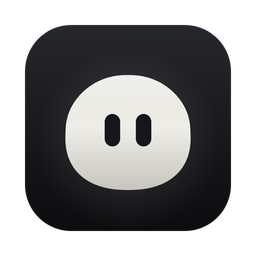
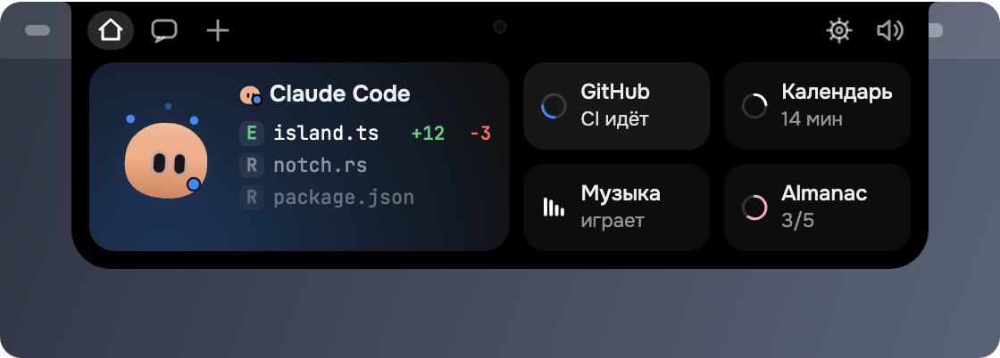
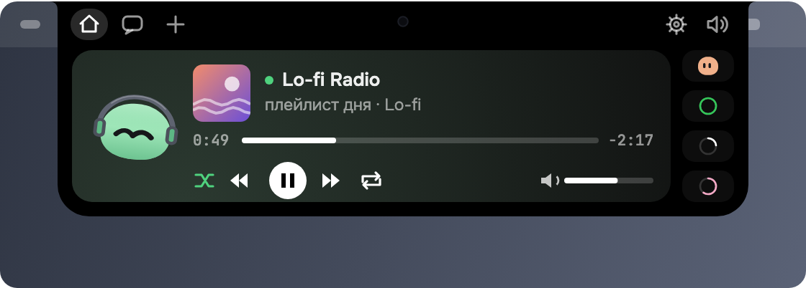
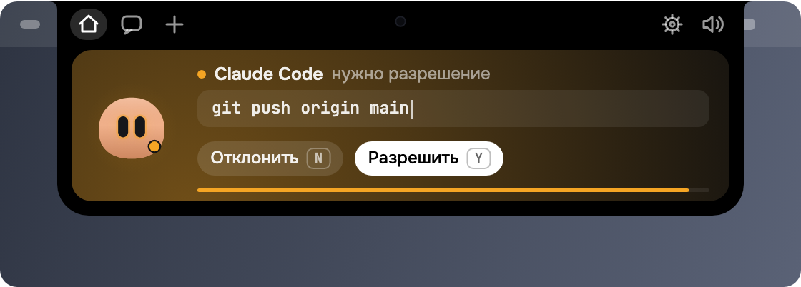
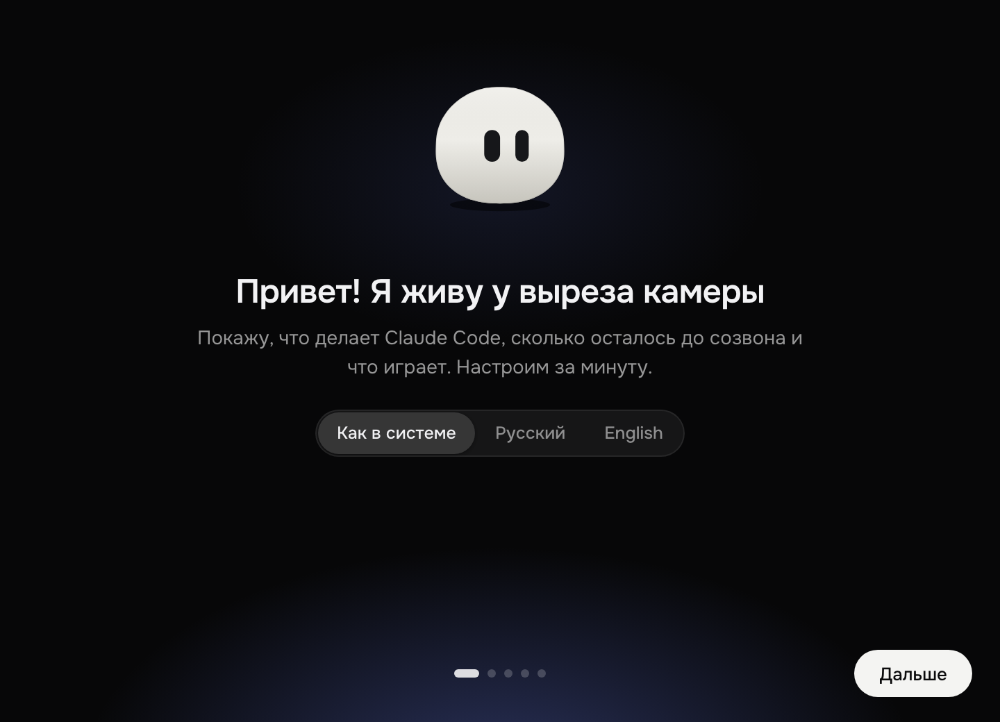
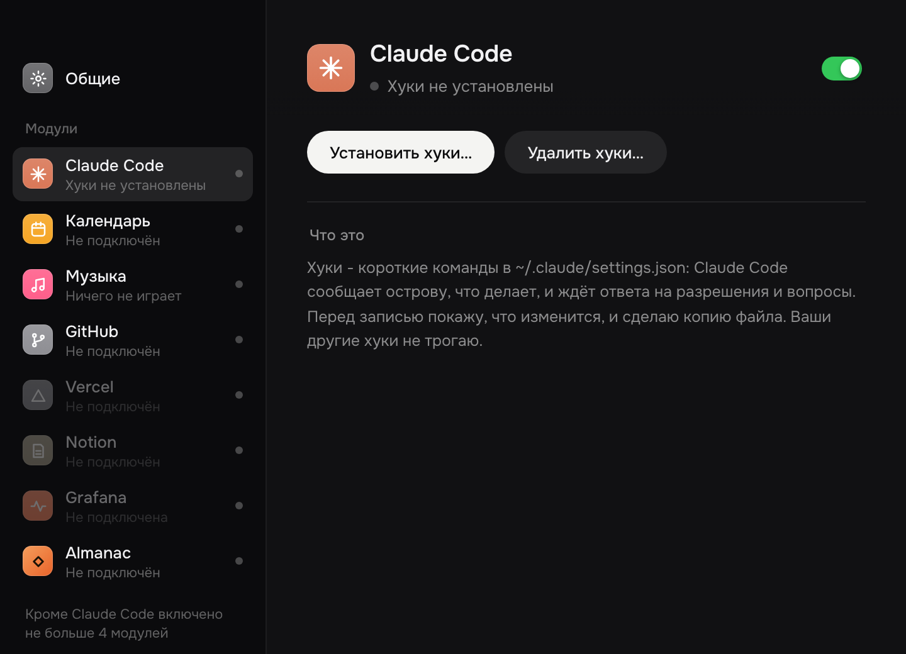

<div align="center">



# Almanac Notch

**Живой остров у выреза камеры.** Маленький маскот и всё, что важно прямо сейчас: ближайший созвон, музыка, CI, деплои, алерты, привычки, агенты - одним взглядом, не отрываясь от работы.

[**Скачать для Mac и Windows**](https://github.com/Sorakiel/almanac-notch/releases/latest) · [Приватность](#приватность) · [Для разработчиков](#для-разработчиков) · [English](#in-english)



</div>

## Что умеет

Остров живёт там, куда взгляд и так попадает, - у выреза камеры MacBook или у верхнего края экрана на Windows. В покое он почти не виден, при наведении раскрывается и показывает карточки модулей. Фокус у окна, в котором вы работаете, он не забирает.

<table>
<tr>
<td width="50%"></td>
<td width="50%"></td>
</tr>
<tr>
<td><b>Видеть главное краем глаза.</b> Сколько минут до созвона, что играет и кнопки плеера, упал ли CI, ушёл ли деплой, горит ли алерт, что осталось из привычек на сегодня.</td>
<td><b>Отвечать, не переключаясь.</b> То, что ждёт вашего решения, приходит в остров: подтвердить, отклонить, выбрать ответ, отметить привычку - мышью или горячими клавишами.</td>
</tr>
</table>

**Маскот - характер острова.** Он следит за курсором, реагирует на клики и события, засыпает, когда ничего не происходит, танцует под музыку, празднует, когда все дела закрыты, и дуется, если его тыкать слишком часто.

### Модули

| | Модуль | Что показывает |
|---|---|---|
| 📅 | **Календарь** | ближайшая встреча и сколько до неё (Mac - системный Календарь, Windows - Outlook или ссылка iCal) |
| 🎵 | **Музыка** | что играет в любом плеере, включая браузер; пауза, перемотка, громкость |
| 🐙 | **GitHub** | последний CI в ваших ветках, PR на ваше ревью, активность за неделю |
| ▲ | **Vercel** | три последних деплоя и их состояние |
| 📝 | **Notion** | недавно изменённые страницы и чужие правки |
| 📈 | **Grafana** | горящие алерты и график выбранной панели |
| ◆ | **Almanac** | привычки на сегодня - отметка прямо с острова |
| ✳️ | **Claude Code** | шаги агента, его разрешения и вопросы с ответом из острова (⌥Y, ⌥N, ⌥1-3), лимит плана; в терминале и в Claude Desktop |

Модули включаются в настройках, одновременно в острове помещается пять. Новые добавляются по общему шаблону. Интерфейс на русском и английском.

## Установка

<table>
<tr>
<td width="50%" valign="top">

**macOS 12+** (Apple silicon и Intel)

1. Скачайте `Almanac_Notch_<версия>_universal.dmg` со страницы [Releases](https://github.com/Sorakiel/almanac-notch/releases/latest).
2. Откройте и перетащите Almanac Notch в «Программы».
3. При первом запуске macOS скажет, что не может проверить разработчика: «Системные настройки → Конфиденциальность и безопасность» → «Всё равно открыть». Это нужно один раз.

</td>
<td width="50%" valign="top">

**Windows 10 и 11**

1. Скачайте [`Almanac.Notch.Setup.exe`](https://github.com/Sorakiel/almanac-notch/releases/latest/download/Almanac.Notch.Setup.exe).
2. Запустите, при желании выберите папку («Изменить»), нажмите «Установить». Права администратора не нужны.
3. SmartScreen спросит про неизвестного издателя: «Подробнее» → «Выполнить в любом случае».

</td>
</tr>
</table>

### Первый запуск



Маскот встретит вас и за минуту всё настроит:

- язык интерфейса;
- Claude Code - хуки ставятся одной кнопкой, перед записью виден дифф и сохраняется копия `~/.claude/settings.json`, чужие хуки не трогаются;
- доступ к календарю;
- какие модули показывать;
- запуск вместе с системой и проверка обновлений.

Любой шаг можно пропустить. Приветствие показывается один раз, при первом запуске; всё то же самое потом есть в настройках.

<br clear="right" />

### Настройки и обновления



Настройки открываются из меню острова. Там подключаются модули: токены GitHub, Vercel, Notion и Grafana, вход в Almanac одной кнопкой через браузер.

Раз в день приложение проверяет, вышла ли новая версия, и ставит её по кнопке «Обновить» - в ту же папку, без лишних окон. Обновления подписаны: приложение не установит файл, подпись которого не сошлась. Проверку можно выключить в «Общих».

<br clear="right" />

### Удаление

Mac - «Настройки» → «Общие» → «Удалить Almanac Notch…». Windows - «Параметры» → «Приложения» или «Пуск» → «Удалить Almanac Notch». Удаление всегда снимает хуки Claude Code из `~/.claude/settings.json` (чужие остаются) и запуск при входе; галочка «Удалить настройки и данные» стирает ещё подключения, токены в системном хранилище и кэш. На Mac приложение уходит в Корзину.

## Приватность

- **Никакой телеметрии и аналитики.** Приложение не сообщает о себе ничего и никому.
- **Сеть - только к тому, что вы подключили**, плюс раз в день GitHub Releases за номером новой версии (выключается).
- **Секреты - в системной связке ключей** (Keychain, Credential Manager), не в файлах и не в интерфейсе острова.
- **Сервер для Claude Code слушает только `127.0.0.1`** и принимает запросы только с токеном.
- В настройках каждого модуля написано, что именно он читает и куда ходит.

Подробно - [docs/ARCHITECTURE.md](docs/ARCHITECTURE.md), раздел «Приватность».

## Для разработчиков

Монорепозиторий на npm workspaces: TypeScript strict, Canvas 2D, Tauri 2 и Rust.

| Путь | Что там |
|---|---|
| `packages/island` | рендер острова и маскота: пружины, глаза, поведение, карточки (без React в цикле кадра) |
| `apps/desktop` | приложение: окно Tauri, Rust-ядро, хуки Claude Code, провайдеры данных, окно настроек |
| `apps/harness` | стенд сверки с прототипом |
| `prototype/` | утверждённый интерактивный прототип - эталон вида и поведения |
| `reference/`, `tools/` | кадры и ролики эталона, скрипты съёмки и сравнения |
| `docs/` | спецификация, архитектура, план, журнал отличий от прототипа |

### Запуск

Нужны [Node.js 22+](https://nodejs.org) и [Rust](https://rustup.rs). На Mac - Xcode Command Line Tools (`xcode-select --install`), на Windows - [Visual Studio Build Tools](https://visualstudio.microsoft.com/visual-cpp-build-tools/) с «Разработкой классических приложений на C++».

```bash
npm install
npm run desktop:dev     # приложение в режиме разработки, с логом
npm run installer       # установщик для своей ОС в release/: .dmg и .app на Mac, Setup.exe на Windows
npm test                # тесты
npm run parity          # сверка кадров с прототипом
```

Модуль Almanac: скопируйте `apps/desktop/src-tauri/almanac-env.example` в `.env.almanac` рядом и впишите адрес проекта и публичный ключ (или задайте `ALMANAC_URL` и `ALMANAC_KEY`). Без них модуль показывает пример привычек.

<details>
<summary><b>Релиз</b></summary>

Установщики собирает GitHub Actions (`.github/workflows/release.yml`) по тегу `v*`: один universal `.dmg` для Mac (фон - `src-tauri/dmg/background.tiff`, рисует `scripts/dmg-background.mjs`), `Almanac.Notch.Setup.exe` для Windows и файлы обновления (`latest.json`, подписанные архивы). Релиз создаётся черновиком.

Setup.exe - наше окно установки (`apps/setup`, страница `setup.html`), внутри - обычный NSIS-установщик Tauri, который запускается тихо: `/S /D=папка`. Собирает его `scripts/setup-exe.mjs` после `tauri build`. Сам NSIS-файл `*_x64-setup.exe` тоже лежит в релизе: его скачивает автообновление и ставит тихо в ту же папку. Удаление на Windows - окно самого приложения (`almanac-notch.exe --uninstall`, `src-tauri/src/uninstall.rs`), NSIS-хуки - `src-tauri/windows/hooks.nsh`.

Секреты репозитория (Settings → Secrets and variables → Actions):

- `TAURI_SIGNING_PRIVATE_KEY` - закрытый ключ подписи обновлений (`~/.tauri/almanac-notch.key`, открытый - в `tauri.conf.json`). Без него установленные приложения не примут обновление: не терять и не публиковать. `TAURI_SIGNING_PRIVATE_KEY_PASSWORD` - его пароль, если есть.
- `MAC_CERT_P12` (`base64 -i ~/.tauri/almanac-notch-sign.p12`) и `MAC_CERT_PASSWORD` - самоподписанный сертификат «Almanac Notch». С ним все сборки Mac подписаны одинаково, и macOS не спрашивает заново доступ к связке ключей и календарю после каждого обновления.
- `ALMANAC_URL`, `ALMANAC_KEY` - адрес и публичный ключ Almanac.

Каждый релиз:

1. `npm run release:version 0.1.1` - версия во всех файлах, закоммитить.
2. `git tag v0.1.1 && git push origin v0.1.1` - через 15-25 минут в Releases появится черновик.
3. Проверить файлы черновика и нажать «Publish release». Установленные приложения увидят только опубликованный релиз. Тег с дефисом (`v0.2.0-rc.1`) создаёт пре-релиз, его автообновление не предлагает.

Чтобы локальная сборка на Mac тоже подписывалась сертификатом, один раз добавьте его в связку «Вход» как доверенный для подписи кода:

```bash
security import ~/.tauri/almanac-notch-sign.p12 -k ~/Library/Keychains/login.keychain-db -P "$(cat ~/.tauri/almanac-notch-sign.pass)" -T /usr/bin/codesign
security add-trusted-cert -r trustRoot -p codeSign -k ~/Library/Keychains/login.keychain-db ~/.tauri/almanac-notch-sign.pem
```

Иконки (маскот) пересобираются `node apps/desktop/scripts/icon.mjs`.

</details>

<details>
<summary><b>Прототип и сверка</b></summary>

Откройте `prototype/island-prototype.html` в Chrome или Safari. Реализация повторяет его до пикселя, сверка - `npm run parity` (кадры) и `npm run parity:inputs` (клики и клавиши), подробности - [docs/PARITY.md](docs/PARITY.md).

| Клавиша | Событие | Клавиша | Событие |
|---|---|---|---|
| 1 | Внимание | 7 | Успех |
| 2 | Работает | 8 | Ошибка |
| 3 | Думает | 9 | Праздник |
| 4 | Ищет | 0 | Привет |
| 5 | Вопрос | Q | Сон |
| 6 | Лимит | | |

Во время подтверждения работают Y и N, во время вопроса - 1, 2, 3. Маскота на сцене можно водить курсором, кликать (3 и 6 раз подряд - отдельные реакции), дважды кликать, гладить по макушке и перетаскивать.

```bash
npx playwright install chromium
npm run ref:screens     # заново снять кадры эталона
npm run ref:clips       # ролики (нужен ffmpeg)
```

</details>

## In English

**Almanac Notch** is a living island at your MacBook's camera notch (and at the top edge of the screen on Windows): a small mascot and whatever matters right now - your next meeting, music, GitHub CI, Vercel deploys, Notion edits, Grafana alerts, Almanac habits, coding agents - at a glance, and things that wait for you (a permission, a question, a habit) answered right from the notch. No telemetry; network only to the services you connect. The interface is in English and Russian.

[Download for Mac and Windows](https://github.com/Sorakiel/almanac-notch/releases/latest). The builds are not signed by Apple or Microsoft yet: on first launch, use "Open Anyway" in System Settings → Privacy & Security on Mac, or "More info" → "Run anyway" in SmartScreen on Windows. On Windows, `Almanac.Notch.Setup.exe` lets you pick the install folder. To uninstall: Settings → General → "Uninstall Almanac Notch…" on Mac, "Apps" or the Start menu on Windows; it always removes the Claude Code hooks and launch at login, and optionally your settings and data.
